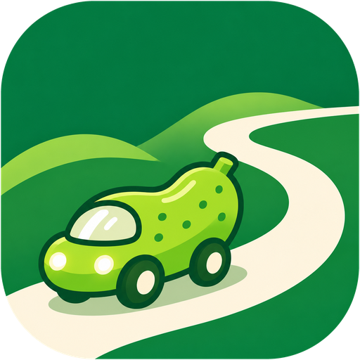
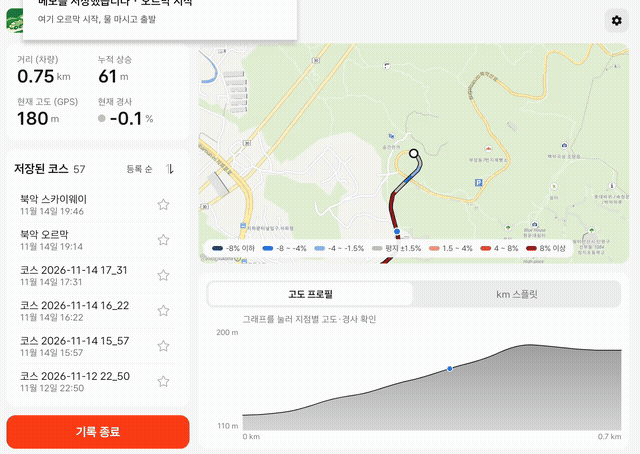
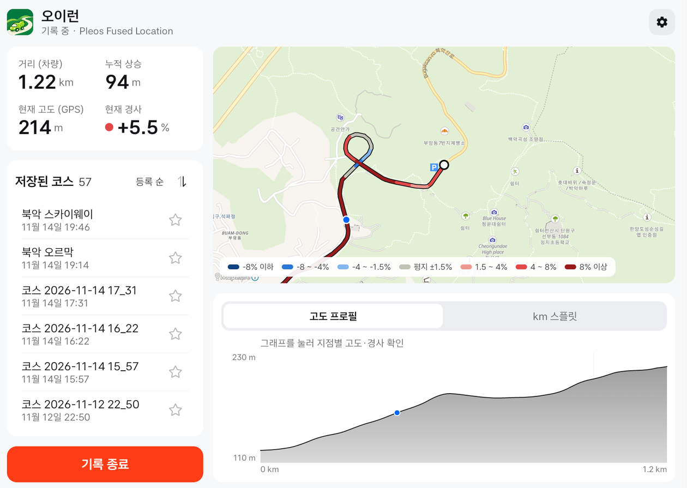
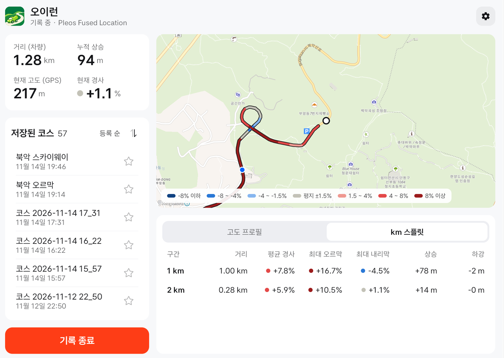
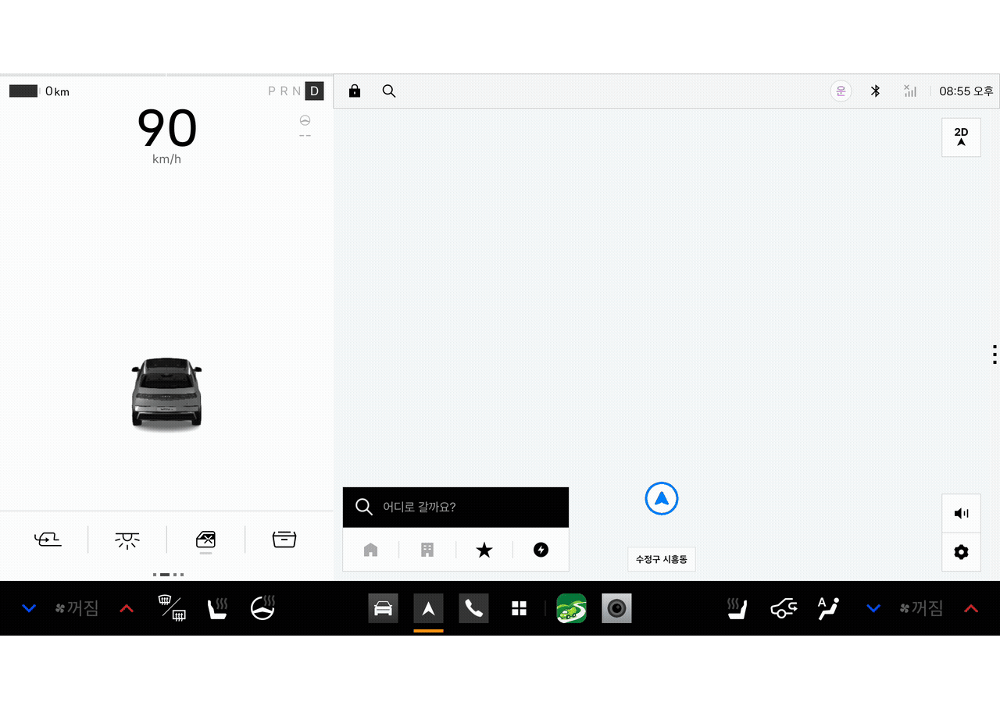
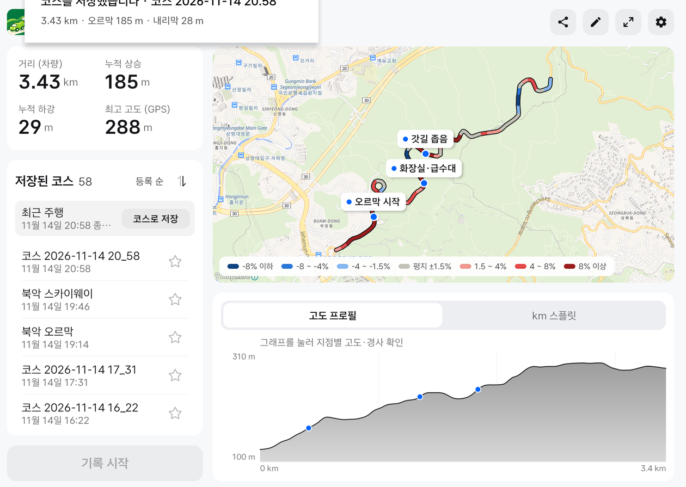
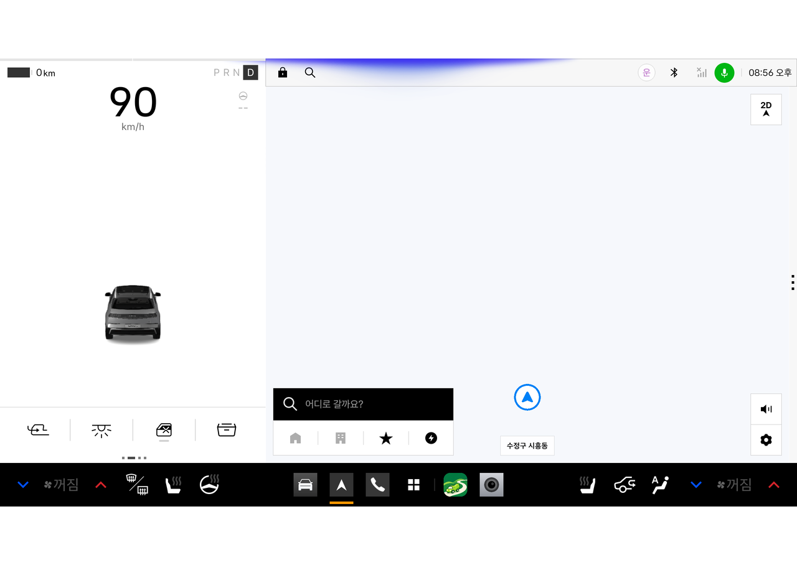
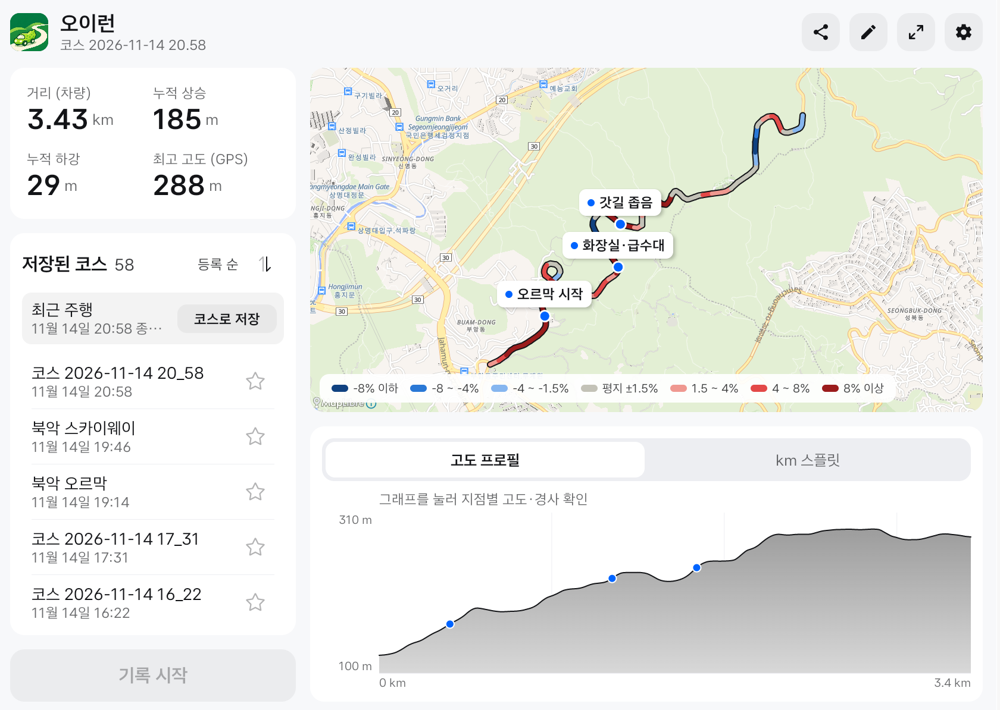
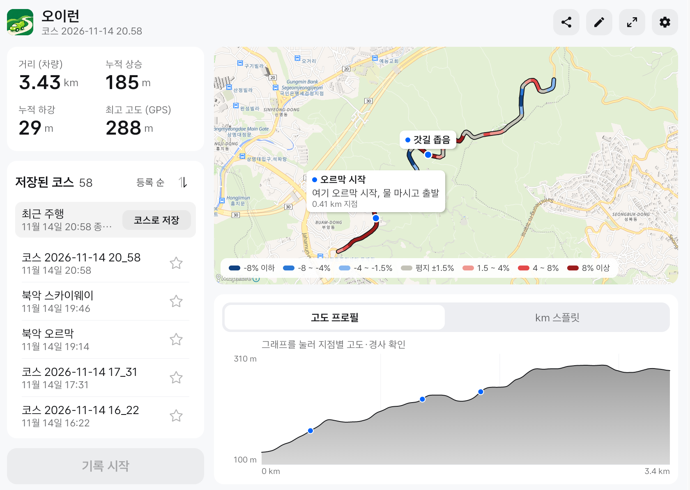
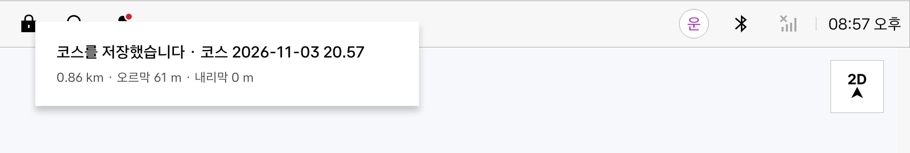

# 오이런

오 이 코스 뛰어보쉴?

오이런은 러닝 코스를 차로 한 번 달려 보면 거리, 고도, 경사를 지도에 담아 주는 Pleos Connect 앱 샘플입니다.
Pleos Fused Location으로 위치와 고도를, 차량 주행거리로 거리를 잡아 경사별 색 지도, 고도 프로필, km 스플릿을 보여 주고 GPX로 저장합니다.
고도는 위치 서비스가 제공한 값을 평활화하여 사용하며, 지도 지형 고도로 대체하지 않습니다. 저장된 GPX를 다시 열 때도 기록된 고도를 사용합니다.







앱을 한 번 열어 권한을 허용해 두면 그 뒤로는 앱을 열지 않아도 됩니다. 기어를 P에서 빼면 주행을 뒤에서 기록하고, 주행 중 마음에 드는 길에서 **앱 아이콘을 누르면** 화면을 띄우지 않고 그 지점의 500 m 전부터 코스로 표시합니다(블랙박스 이벤트 저장처럼). 아이콘을 한 번 더 누르면 표시한 지점부터 지금까지의 거리·고저차를 보는 화면이 열리고, **기록 종료**를 누르거나 P로 바꾸면 그 구간을 코스로 저장한 뒤 화면 왼쪽 위에 알림을 띄웁니다. 알림을 누르면 그 코스가 열립니다. 표시한 지점부터 500 m 이하면 저장하지 않고 알림으로 알립니다. 앱에 '다른 앱 위에 표시' 권한이 있으면 P에서 코스 목록 화면을 바로 띄우고, 다시 D로 바꾸면 화면을 닫아 내비로 돌아갑니다. 주차 중에는 새 코스를 기록할 수 없습니다.





주행 중에 길에서 기억해 둘 것이 있으면 글레오에게 "오이런에 메모해줘, 여기 화장실 있음"처럼 말합니다. 글레오는 말을 다 듣고 나서 앱을 부르기 때문에 그사이 차가 지나간 만큼 위치가 밀리는데, 앱이 글레오가 듣기 시작할 때 내는 소리를 감지해 두었다가 그 순간의 위치에 메모를 붙입니다. 메모는 코스와 함께 GPX 웨이포인트로 저장됩니다. 주차 후 코스를 열면 지도의 파란 점 위에 메모의 짧은 이름이 말풍선으로 뜨고, 말풍선이나 점을 누르면 메모 전체와 코스 몇 km 지점인지가 펼쳐집니다. 고도 그래프에도 같은 자리에 파란 점이 찍힙니다. 글레오가 실제로 앱을 부르려면 Pleos가 앱의 연동 정의(`app/src/main/assets/schema.json`)를 승인해야 해서, 에뮬레이터에서는 글레오 세션을 띄운 뒤 앱 호출을 adb로 흉내 내 확인했습니다. 짧은 이름은 글레오가 메모와 함께 주면 그것을 쓰고, 없으면 메모 앞부분을 씁니다. 글레오가 실제로 이름을 채워 주는지는 승인 뒤에 확인할 수 있어, 스크린샷의 이름은 시험할 때 직접 넣은 것입니다.







표시하지 않은 주행은 코스 목록에 쌓지 않고 **최근 주행**으로 다음 주행 전까지만 보관합니다. 지나고 나서 아쉬운 길이 있으면 저장된 코스 위의 최근 주행에서 **코스로 저장**을 누릅니다. 저장하면 최근 주행은 코스 목록으로 옮겨집니다. 주차 중에 앱 아이콘을 누르면 평소처럼 앱이 열립니다.

저장된 코스 오른쪽의 별을 누르면 노란색으로 바뀌고 즐겨찾기로 목록 상단에 표시됩니다. 다시 누르면 해제되며, 즐겨찾기는 앱을 다시 열어도 유지됩니다.

목록은 기본적으로 최근 기록순입니다. 제목 오른쪽의 정렬 기준을 누르면 **등록 순·총 길이·이름**을 선택하고, 위아래 화살표를 누르면 오름차순·내림차순을 전환합니다. 즐겨찾기는 항상 상단에 표시됩니다.

주차 중에 코스를 열고 위쪽의 연필 버튼을 누르면 코스 이름을 바꿀 수 있습니다. 순서와 즐겨찾기는 그대로 유지됩니다.

저장된 코스는 항목을 왼쪽으로 밀어 삭제합니다. 삭제 직후 5초 동안 표시되는 **삭제 취소**를 누르면 복원됩니다. 연속으로 삭제했다면 아직 5초가 지나지 않은 코스를 함께 복원합니다.

스테이 모드(P)에서는 **전체 화면**을 눌러 지도와 고도 프로필을 화면 전체로 볼 수 있습니다. **전체 화면 종료**나 뒤로 가기로 기본 화면에 돌아오며, 기어를 P에서 빼면 자동으로 전체 화면을 닫고 주행 기록을 이어갑니다. Pleos Emulator v2.1.0에서 확인했습니다.



미리 생성한 3km·5km·10km·하프(21.0975km)·풀(42.195km) GPX를 각각 5개씩, 총 25개 앱에 포함합니다. 앱 실행 시 경로를 계산하지 않고 **저장된 코스** 폴더로 복사합니다. 여의도·반포·뚝섬 한강공원, 탄천, 중랑천의 OpenStreetMap 보행 경로를 사용하며 실제 대회 공인 코스는 아닙니다. 이전 근사 좌표 샘플은 수정되지 않은 파일만 자동 보정하고, 사용자 기록·수정·삭제는 보존합니다.

## 실행 방법

- **APK로 설치**: [최신 릴리스](https://github.com/Team-OiShi/OiRun/releases/latest)에서 `OiShi_OiRun_release.apk`를 받아 `adb install OiShi_OiRun_release.apk`로 설치합니다. 직접 빌드한 디버그 앱이 설치되어 있으면 서명이 달라 먼저 지워야 합니다.
- **소스에서 빌드**: JDK 21(Android Studio 번들 JBR 21)과 Android SDK 35로 빌드합니다.

  ```sh
  ./gradlew testDebugUnitTest assembleDebug
  adb install -r app/build/outputs/apk/debug/app-debug.apk
  ```

- 처음 열 때 위치(Pleos Fused Location)와 알림 권한을 허용합니다. P에서 코스 목록을 바로 띄우려면 설정에서 '다른 앱 위에 표시'도 허용합니다. 그 뒤로는 앱을 열지 않아도 기어를 P에서 빼면 주행을 기록합니다.

## 테스트 환경

| 항목 | 내용 |
| --- | --- |
| 에뮬레이터 | Pleos Connect Emulator v2.1.0 (Android 14, API 34) |
| 화면 | 2560×1440, 160 dpi. Pleos의 가로·세로 앱 창을 모두 지원 |
| 빌드 | Android Studio, JDK 21, compileSdk·targetSdk 35, minSdk 28 |
| Pleos SDK | Vehicle 2.3.2, FusedLocation 1.1.3 |

## 오픈소스 라이선스

| 구성 요소 | 라이선스 |
| --- | --- |
| [MapLibre Native for Android](https://github.com/maplibre/maplibre-native) 13.7.1 | BSD-2-Clause |
| AndroidX(Core, Lifecycle, Activity), Jetpack Compose, Material 3 | Apache License 2.0 |
| Kotlin, kotlinx.coroutines | Apache License 2.0 |
| JUnit 4(단위 테스트에만 사용) | Eclipse Public License 1.0 |

| 데이터 | 출처 |
| --- | --- |
| 지도 타일 | [OpenFreeMap](https://openfreemap.org/) © [OpenMapTiles](https://openmaptiles.org/), 데이터 [© OpenStreetMap contributors](https://www.openstreetmap.org/copyright)(ODbL 1.0) |
| 샘플 경로 좌표 | [© OpenStreetMap contributors](https://www.openstreetmap.org/copyright), ODbL 1.0. 보행 경로는 [FOSSGIS OSRM](https://routing.openstreetmap.de/about.html)으로 계산 |
| 샘플 경로 고도 | [Terrain Tiles](https://registry.opendata.aws/terrain-tiles/)(Mapzen, AWS Open Data; 한국 지역은 SRTM). [출처 표기](https://github.com/tilezen/joerd/blob/master/docs/attribution.md)를 따름 |

Pleos Vehicle·FusedLocation SDK는 Pleos Playground에서 제공하는 SDK이며 오픈소스가 아닙니다. 샘플 GPX의 출처는 `app/src/main/resources/sample-courses/NOTICE.txt`에도 적혀 있습니다.
